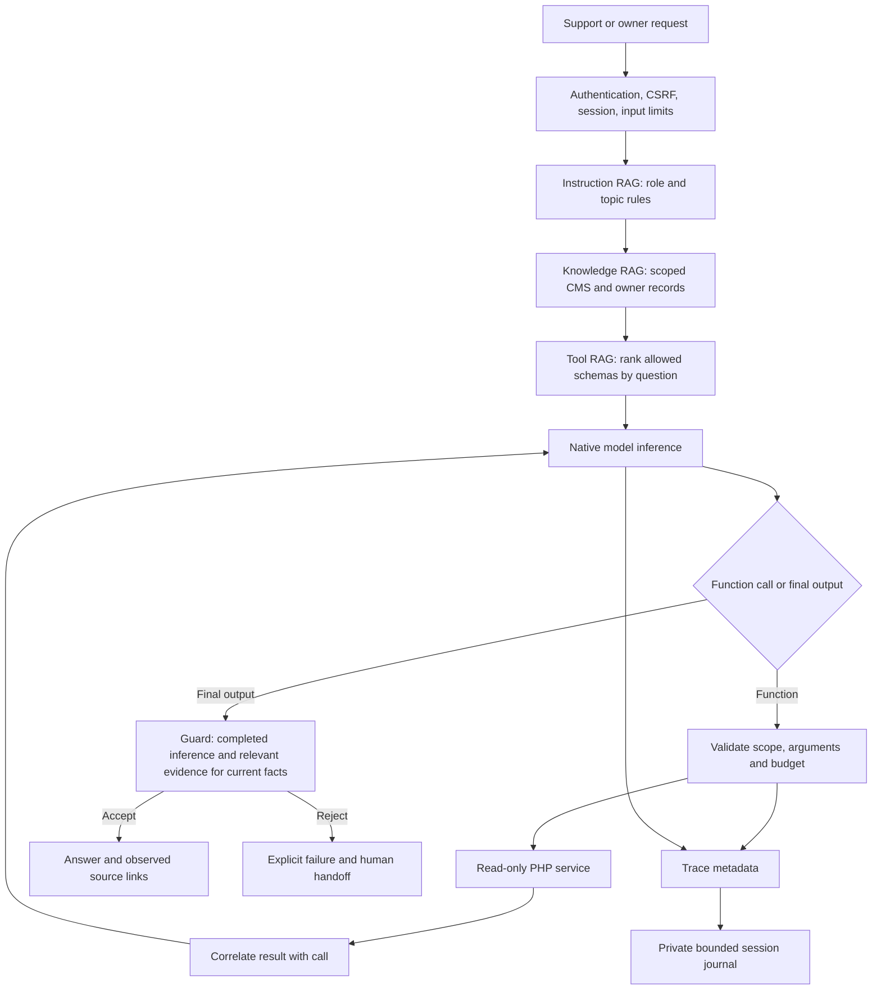

# Native agent harness and retrieval contract

Issues #128, #82 and #134. The PHP/MySQL/JavaScript runtime adapts documented OpenAI patterns, without a hosted orchestration service, embedding index, or Agents SDK dependency.

- Instruction RAG uses the versioned `config/agent-instructions.php`: shared, role and topic rules. Treat source records and the question as data, not instructions.
- Knowledge RAG uses visible practitioners, published programme bodies and published blog passages in `ClinicKnowledgeService`. Rank up to five title/paragraph matches; this is lexical search, not semantic embedding search. Retrieve exact programme details by validated slug. Owner aggregates and public/customer data have separate scopes.
- Tool RAG uses `AgentToolRegistry`: role/module filtering and question-dependent schema ranking, not provider-hosted deferred tool search. Expose the small allowed catalogue (fewer than 20) and validate each native call again. Unknown names, invalid types, extra keys and missing required values fail closed. Chat Completions uses strict function schemas and nullable optional arguments.
- Native execution uses Google functionDeclarations/functionResponse and Chat Completions assistant tool_calls plus tool messages with the same tool_call_id. No plain-generation downgrade for conversational business lookups, including secondary Gemma. Direct final responses are accepted when the model legitimately needs no tool. Unsupported protocols fail explicitly; Anthropic native tool protocol is not implemented. Navigation, ticket submission and account permission notices are application actions, not model answers.
- Execution bounds: four provider rounds, eight tool calls, bounded request/result size and provider deadlines. Google REST HTTP 503 receives at most one identical transport retry per provider round, after approximately one second plus jitter and only within the existing deadline. This does not replay PHP tools or count as a separate failed logical turn. HTTP 400/401/403/429 and ambiguous timeouts are not retried blindly. See https://ai.google.dev/gemini-api/docs/troubleshooting#retry-strategy. Reject invalid/duplicate completion call identifiers; exhausted loops fail. These are application limits, not a guarantee about total network latency.
- Output acceptance requires a completed usable model response; current business facts require relevant model-selected evidence. Greetings, clarification, general explanations and creative tasks may return a direct model response without a tool. Native-tool diagnostics retain a strict tool requirement. Initial requests carry minimal role/module/session metadata, not an eager owner aggregate or public catalogue dump. Model-selected bounded results are kept only for the current exchange and checked before accepting facts. The response modes model_direct and model_with_retrieval distinguish direct inference from actual retrieved evidence. A model switch clears the prior exchange evidence but retains operational attempt metadata. Known named practitioner qualification/registration and programme duration checks reject missing facts; the reported persona echo is rejected. These checks do not prove every possible claim. Actual source links are derived from tool results. Old conversation-state versions are invalidated.
- Trace correlation records provider attempts, model vs harness tool origin, hashed call reference, duration, status and provider-reported token counts. It excludes raw tool payloads, prompts, credentials and hidden reasoning. Private JSON session journals contain redacted visible conversation plus traces, subject to consent, permissions and size limits. Operational traces and private transcripts are distinct.
- Evaluation: deterministic loopback provider fixtures test actual call/result protocols, unauthorized tools, malformed arguments, duplicate identifiers, looping calls, provider outage, direct conversational completion, rejected ungrounded fee/count, persona echoes, session boundaries, source checks and replay. HTTP 200 alone is not an acceptable inference.

## Sources

[OpenAI Function calling](https://developers.openai.com/api/docs/guides/function-calling) · [Retrieval](https://developers.openai.com/api/docs/guides/retrieval) · [Tool search](https://developers.openai.com/api/docs/guides/tools-tool-search) · [Guardrails](https://openai.github.io/openai-agents-python/guardrails/) · [Tracing](https://openai.github.io/openai-agents-python/tracing/) · [Agent workflow evaluation](https://developers.openai.com/api/docs/guides/agent-evals) · [Harness engineering](https://openai.com/index/harness-engineering/) · [Google Gemma on Gemini API](https://ai.google.dev/gemma/docs/core/gemma_on_gemini_api).

26 Nov 2026 synthetic real-provider probe: 31B returned no complete HTTP response within 12 seconds; 26B returned HTTP 503. No native tool call observed. This does not establish unsupported capability. Keep #82 open until real successful inference plus retrieval is observed.

## Release

Initialize the declared agent_sessions collection using the existing authenticated schema migration; seed already published telephone and WhatsApp numbers only when the canonical settings fields are absent. Preserve explicit owner settings. Verify owner-only JSON downloads and failure paths before deployment. Never use production medical/customer data in evaluations.

### Gemma native REST protocol
Both configured Gemma 4 models have native function support. Google declarations use uppercase REST schema types and omit parameters for no-argument functions. Preserve the full returned model parts as JSON objects (including empty argument objects and opaque thought signatures); correlate functionResponse by the returned ID when present. Use the documented Gemma thinking level, no OpenAI-only fields or forced unsupported mode. Keep instructions separate and retrieve source data through tools rather than repeating a large precomputed data dump. The isolated protocol fixture verifies this round trip for both models and both surfaces. A second minimal live REST probe, without optional generation settings, returned HTTP 503 for both configured models; no call was returned. The live provider remains unverified, not classified as incapable.

The shared `published_consultation_fees` tool returns only published fee cards, integer minor units, currency, display amount, duration, inclusions and the actual Contact source. Both agent surfaces require it for explicit consultation fee questions. Known named fee amounts are checked against the answer; no inference fallback or payable session is created.

### Editorial completion contract

Blog editor proposals and Enterprise structured drafts use the same configured AiClient, without irrelevant retrieval. Require explicit natural completion (`stop` for Chat Completions, `STOP` for Google); reject length-limited, blocked, missing or tool-call-only output. Plain visible text excludes thought parts. The editor validates the proposal and requires explicit Apply followed by ordinary Save; provider error details never replace the source article. Model-generated owner-only fields are ignored. See #140 and the REA register.

### Pinned provider diagnostics

Use the saved model configuration with either `./bapXcms ai:probe text [model]` or `./bapXcms ai:probe tools [model]`, or Admin → Integrations → Verify the AI connection. Text requires the exact fresh challenge and natural finish. Tools mode requires exactly one valid synthetic read-only call followed by the correct hidden challenge. The diagnostic shares the native transport but cannot read business records, switch production model, or change production failover counters. Trace metadata contains observed status, duration, call reference and provider usage only. A diagnostic passing is not agent-surface acceptance. See [the reference-derived contract](research/rea/contracts/provider-diagnostics.md).

### Native typed ability migration

Twelve active names use native v1 contracts: six public reads, five owner operational reads and one trusted support-session context. Six former retail names were intentionally retired under the standalone CMS scope; historical evidence is retained. NativeAbilityRegistry owns versioned metadata, scope, bounded input/output validation and safe error codes. Missing canonical fee settings is unavailable, not empty success. The [ability audit](research/rea/contracts/native-abilities-audit.md) maps remaining legacy tools and verification obligations. External MCP transport remains incomplete; the internal catalogue migration is complete.

## External MCP published reads

The scoped /mcp transport uses the native registry for the six published clinic abilities, with current module gates. It is not a third agent surface. Independent expiring/revocable bearer grants are provisioned explicitly through the authorized operator CLI; no browser cookie or provider credential authorizes MCP. See [the pinned transport contract](research/rea/contracts/mcp-read-transport.md). Legacy clients, OAuth onboarding and live authenticated client acceptance remain separate.

## A2UI read-only result surfaces

The chat endpoints optionally attach one native A2UI 1.0 literal snapshot
from validated observed tool results. The shared PHP catalog and JavaScript
renderer use the same bounded component vocabulary and strict tree rules.
Only the approved role-scoped projections are shown; raw tool payloads and
model-authored executable content are not passed to the renderer. Text
answers remain usable without the optional script. No UI actions, dynamic
bindings or model-negotiated rendering are implemented yet. See
[the native catalog contract](research/rea/contracts/a2ui-native-catalog.md).
