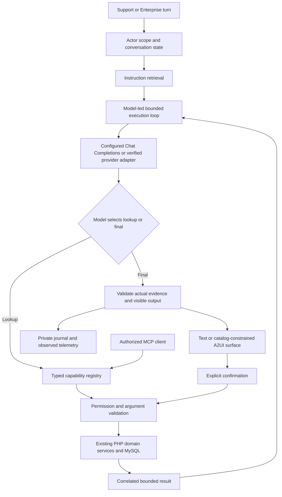

# REA research and capability delivery workflow

This directory is the source-backed delivery contract for the reusable native bapX PHP platform as implemented in Nebo Wellness. The goal is not to install or clone another product. Research provides contracts and independently testable requirements; the existing application supplies native implementation.

## Start here

- [Native REA skill library](../../../.agents/REA/README.md): 22 individually
  adapted guides, pinned official skill snapshots, source locator and
  capability routing, license and digest inventory. Use ./bapXphp rea skills.
- [Progress report](progress.md): generated per-track counts and remaining work.
- [Canonical capability register](capabilities.json): stable IDs, status, acceptance criteria, source/test anchors, reference locators, issue links and production observations.
- [Evidence manifest](evidence/manifest.json): archive/commit provenance, digests, analysis boundaries and public documentation.
- [Historical CMS/commerce findings](evidence/historical-platform-matrix.json) and [agent audit](evidence/historical-agent-audit.md): prior bapX research, not claims of current Nebo delivery.

REA 6.8.0 historical source graphs are partial static evidence. WordPress 7.1.4, WooCommerce 11.3.0, and Site Kit 1.192.0 use exact archive hashes. WordPress MCP and A2UI are pinned Git source trees. A2UI uses the current v1.0 specification in the pinned tree, not legacy v0.8/v0.9 message formats. Ten selected DeepSeek Harness files match commit 39163dd30f703a79079e2d2446545cff3c453738 byte-for-byte. The previously installed workspace is not itself proof of the harness source revision. OpenAI API references are public protocol documentation, not a reverse-engineered proprietary model. The supplemental archive member digest record covers paths not present in the earlier selected REA graph.

The source archives, extracted vendor runtime, and larger REA raw graph/capture bundles remain in the owner's research folders. Curated research findings, public-source digests and pinned official skill guidance are committed. Imported skill helper code is archived as non-executable text under .agents/REA/reference/. Never commit private conversations, production data, credentials, runtime captures, or downloaded third-party executable code.

## Scope and measurement

Each stable component ID represents one deliberately scoped acceptance unit, weighted equally. A status must mean the following:

- **implemented**: native source is present, the specified acceptance behavior has applicable passing tests, and the evidence paths and anchors are recorded. Source/fixture acceptance is not necessarily production acceptance.
- **partial**: source exists, but a stated acceptance condition remains incomplete or unverified. Score zero until that condition is satisfied.
- **missing**: no working native implementation within the stated scope. Score zero.
- **production observation**: separate dated scenario and issue evidence identifying the reported release. This is not a full live acceptance certificate, especially while exact deployed revision verification is outstanding (#138).

Implementation coverage = implemented count / in-scope component count × 100. Production-observation coverage = components with recorded live observation / in-scope component count × 100. No half-credit or estimated percentages. These are scoped capability counts, not effort estimates or percentages of all WordPress/WooCommerce/DeepSeek features. The original denominator is 61 components; changing scope must increment scope_revision, explain why, and preserve historical review entries. Do not quietly remove difficult requirements or reinterpret existing IDs.

**Commerce scope:** do not pursue general WooCommerce parity. Preserve existing shop functionality, but this research track only adapts capabilities needed for service booking, custom enquiry fields/forms, landing pages, approval, fees and necessary payment/receipt lifecycle. No general product/inventory/shipping/marketing expansion. Defer the installer until the reusable core is accepted.

## Engineering contract

One native PHP/MySQL/JS implementation, independent of the reference repository, with no third-party plugin installation, vector store or paid orchestration runtime.

1. **WordPress CMS:** adopt the native workflow concepts: one canonical site profile, authored pages and sections, draft/preview/publish, revisions and stale-write protection, media ownership, accessible filtered admin lists, permissions and system health. Reuse current services before adding new ones.
2. **Service workflows:** a submitted form is an enquiry, not a confirmed appointment. Preserve typed field IDs, validated consent, revision checks, booking state transitions and payment verification. Only confirmed user action may mutate records.
3. **Site Kit:** use official Google APIs and explicitly selected properties; distinguish real metrics, empty, stale, denied and unavailable states. Do not calculate invented conversion rates or fabricate PageSpeed values. Respect consent and avoid private/health information in marketing measurement.
4. **Abilities and MCP:** define a provider-neutral ability once (version, name, input/output schema, read/write annotation, actor/module permission, handler). Discovery and inspection are scoped; execution validates identity, permission, arguments, outputs and budget again. MCP transport exposes these same abilities through its negotiated protocol, not arbitrary SQL or a second business implementation. Native HTTP authorization must be independently tested.
5. **A2UI v1.0:** use a versioned native component catalog and schemas, separate UI structure from data, and validated create/update/delete surface messages. Bind UI functions to authorized caller and typed operation, correlate results, and keep a text fallback. A displayed form is a proposal, not a committed write. No generated executable JS or HTML.
6. **OpenAI-compatible model endpoint:** use configured Chat Completions as a provider-neutral transport target. Keep a capability profile for provider/model-specific parameters rather than assuming every "compatible" endpoint implements all options. A genuine model decides whether tools are needed. Use auto tool choice for normal conversation; required only for diagnostics or an explicit necessary operation. Preserve assistant tool_calls, validate each declared function and arguments, correlate tool results by tool_call_id, then obtain a completed final response. Current business claims require relevant evidence; greetings and writing need no artificial tool. Keep provider failures distinct from inference. Do not silently downgrade or force a model/endpoint migration until actual capability probes pass.
7. **DeepSeek-inspired harness:** adapt selected contracts, not its JavaScript runtime. Actor-scoped session identity, instruction/business-knowledge/tool retrieval, model-led bounded execution loop, durable ordered events and result receipts, checkpoint/recovery and safe replay, projections for owner/Support, bounded privacy-aware telemetry and golden evaluation. Model-visible reference data must be attributable to the actual exchange. Never reuse a failed attempt's evidence for a different model response.

### Shared architecture



This diagram is the target contract. The progress register distinguishes implemented and missing elements; it does not assert full parity.

## Reference-to-native component engineering

A feature name or benchmark is not an architecture. Before implementing a
multi-layer component, follow the archived REA locator into the exact pinned
source and inspect the owning entry point, dependencies, schemas, operations,
state transitions, side effects, permissions and failure branches. Verify the
selected source hash; identify what is observed statically versus tested at
runtime. Then write a small component contract covering the native design,
deliberate differences for shared hosting, invariants, error behavior and
boundary tests. A matching UI, generated map, passing superficial assertion or
completion percentage is not proof of the reference behavior.

Keep concrete contracts in [contracts/](contracts/); for example the
[deployed-source identity contract](contracts/release-identity.md).
Link them from the relevant issue and append-only capability review. Reuse
existing implementation when it already satisfies the contract. Reconstruct
additional reference paths only when the archived evidence is insufficient.

## Mandatory update workflow for every relevant PR

1. Read AGENTS.md, this workflow, the current progress report, applicable capability IDs, reference evidence and matching project skill. Select the native REA adaptation from ./bapXphp rea skills and record it in the issue/contract. Follow its explicit data/permission/state and verification obligations; use vendor originals only as evidence. Search open/closed issues and PR history; inspect exact current source and a relevant reference file/schema. Reuse existing capabilities; do not treat a historical gap as current.
2. Identify the scope and issue, then reproduce the failing behavior using an actual boundary test. Record expected behavior and evidence. For newly researched scope, update the manifest with pinned version/hash and limitations; keep original evidence immutable and add a new record.
3. Implement a focused change in the canonical checkout. Run the relevant real fixtures, local CI, self-review and production tests as applicable. Clearly separate static research, synthetic provider, isolated database, local browser, production browser and actual external provider results.
4. Update the affected component rows in capabilities.json: status, remaining finding, precise source and test anchors, issue references, and separately dated production observation if actually observed. Append a unique updates entry with date, issue IDs, affected component IDs and concise reason/evidence. If a runtime change does not affect a tracked capability, still append a review entry with empty component list and explain why. Do not edit prior review entries to hide history. Scope changes require a higher scope_revision and a new review entry containing scope_change rationale.
5. Run:
   ```sh
   ./bapXphp rea status
   ./bapXphp update
   ./bapXphp rea check
   ./bapXphp rea skills-check
   ./bapXphp ci
   ```
   The update command regenerates the progress report before maps/indexes. The check validates reference digests, exact source/test anchors, stable IDs and report drift. PR CI also checks the base-to-head runtime change against a new register review. The tooling verifies record integrity, not semantic correctness of every acceptance claim: the implementing agent still owns evidence and release review.
6. Push one PR, verify exact-head checks, merge, deploy and repeat the affected live flow. If deployment/provider/client approval remains unverified, keep the corresponding issue open. When live evidence is acquired, record it in a follow-up registry update without inflating implementation coverage. If a previously accepted behavior regresses, demote it immediately and record the regression; percentages may decrease.

## Continuous delivery and reporting

Follow AGENTS.md continuous verified delivery. Finish each scoped issue through
tests, exact-head review, merge, live source and behavior verification, and
register evidence. Then use the updated capability register and issue
dependencies to select and start the next clear authorized loop. At reporting
boundaries include both what was completed and what remains, with precise
acceptance gates; explain material uncertainty rather than stopping at a generic
status. Provider/client blockers remain visible and do not justify fake success
or prevent independent safe implementation.

## Next implementation sequence

Restore the real article drafting and provider diagnostics (#140, #82, #128) and verify release identity (#138). Build canonical site profile and reusable page/form/FAQ editor (#121, #125), including revision-safe publishing. Finish owner CRM and service payment acceptance (#134, #63). Implement typed abilities first, then native MCP discovery/auth/transport and A2UI catalog/renderer/actions. Improve durable journal/recovery and golden evaluation using DeepSeek evidence. Finish native Google reporting, PageSpeed and consent-aware attribution (#65, #58). Use independent issue-scoped PRs; do not batch unrelated runtime changes merely to raise a percentage.
