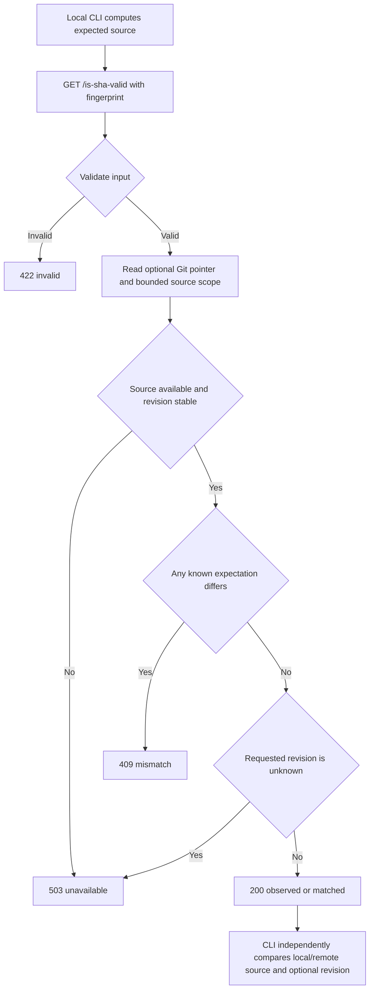

# Component contract: deployed-source identity (cms-13, issue #138)

## Reference evidence before design

The archived WordPress 7.1.4 REA graph (evidence/wp-source.json, path
wp-admin/includes/class-wp-site-health.php) records source SHA-256
d7517a0ddaa8b59b15265febafc6545357ab53e3f982c50c8296b37484af654d.
Re-read the actual selected source and verified its bytes against that digest.

| Reference symbol | Observed source contract | Native adaptation |
|---|---|---|
| WP_Site_Health::get_tests | Registers distinct direct checks by stable name, including PHP, SQL, schedules, REST and SSL; separates check identity from execution | A versioned deployed-source identity check, not a generic health score |
| WP_Site_Health::perform_test | Invokes a specific callback and returns the structured result | One ReleaseIdentityService shared by the HTTP route and CLI |
| WP_Site_Health::get_test_rest_availability | Uses a bounded real HTTP request; distinguishes transport failure, unexpected status and response checks | Local CLI requests the actual deployed origin with an expected fingerprint and compares the response, rather than trusting GitHub CI |
| WP_Site_Health::get_test_scheduled_events | Distinguishes unable to inspect, missed events, late events and normal operation | An unavailable result must not become a passing check; scheduler remains independent work |

References: https://developer.wordpress.org/reference/classes/wp_site_health/
and the archived graph. These are observed static contracts, not an execution of
WordPress. WordPress does not implement Nebo's proposed Git fingerprint endpoint.
The adaptation is independently engineered for shared hosting using Hostinger's
documented auto-deployment and history behavior
(https://www.hostinger.com/support/1583302-how-to-deploy-a-git-repository-in-hostinger/)
and Git repository layout
(https://git-scm.com/docs/gitrepository-layout.html).

## Boundary and dependencies

- Input: optional full 40-character Git SHA-1 and/or 64-character SHA-256 source fingerprint; never a filesystem path, command or URL in the HTTP route.
- Authority: repository root, bounded selected source files on disk, and optional regular .git/HEAD, refs/heads and packed-refs metadata.
- The Git revision is a reported checkout pointer, not proof that the tree is clean or that the revision exists remotely.
- The fingerprint domain is bapx-deployed-source-v1. Sort relative paths bytewise; hash each selected file's exact bytes, then SHA-256 the domain and path/digest records. Paths matter as much as bytes. Mandatory roots and entry files fail closed when unavailable.
- Included: index.php, .htaccess, storage/schema/collections.php, PHP source in app/api/views/integrations, the selected code-only configuration files, root JS/CSS/HTML assets and CSS/PWA source roots. Excluded: database connection configuration, .env, runtime state, uploads, images, fonts, docs, Git objects, and installation-specific records.
- Limits: 8,000 inspected entries, depth 16, 64 MiB read budget, monotonic five-second scan budget; no arbitrary symlink traversal, shell execution or database query.
- PHP on-disk fingerprinting is not cryptographic remote attestation, an atomic snapshot, a full Git tree hash, an OPCache inspection, or a production workflow test. A source match does not certify currently executing opcodes, configured integrations or customer records.

## Execution and observable states

The endpoint emits JSON, no-store/noindex, nullable revision and match flags,
the fingerprint and file count; no raw file list, private values, or path errors.
The local verifier uses an explicit HTTPS deployment origin with TLS verification
(no redirect), bounded response and timeout. Loopback HTTP is available for tests.
Unknown remote Git metadata is a distinct source-only match, not a successful SHA
assertion. A known Git mismatch fails even when the selected bytes match.

## Implementation, acceptance and next boundary

- app/Services/ReleaseIdentityService.php: validation, optional metadata, bounded source inspection.
- app/Controllers/ApiController.php and ProjectMapService.php: registered GET endpoint.
- cli/release-identity.php and bapXphp: local observation and remote comparison.
- tests/run.php: restored red test, loose/packed/detached refs, unknown/malformed expectations, source drift, excluded configuration and upload bytes, unsafe links and missing required files.
- cli/smoke-local.php: actual local HTTP matching/mismatch/invalid, cache policy and CLI comparison.
- Production: after merge, compare actual origin to synchronized main and probe affected flows. Record a reported revision only if available and exact source fingerprint separately. Re-test if deployment is still propagating.

No scheduler, WordPress plugin, system-health owner dashboard, or new production
dependency has been added. cms-13 remains partial until the scheduler and other
health acceptance requirements are implemented.
